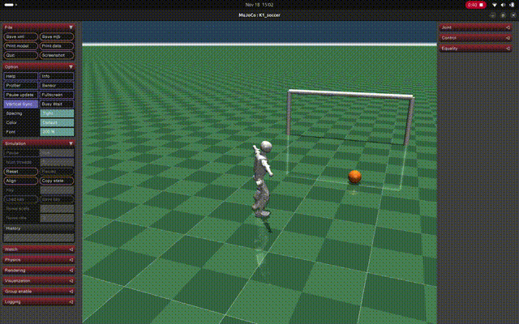
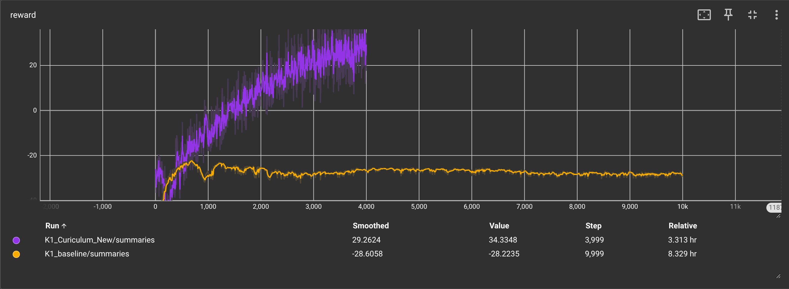
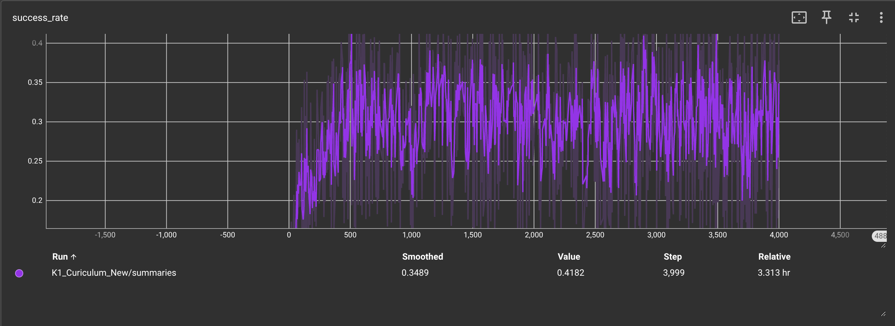
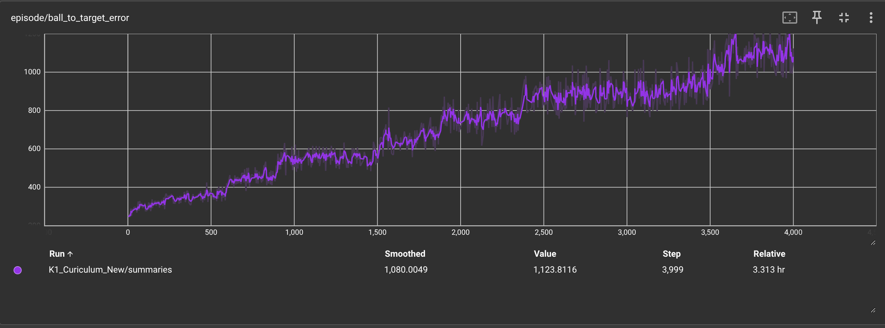
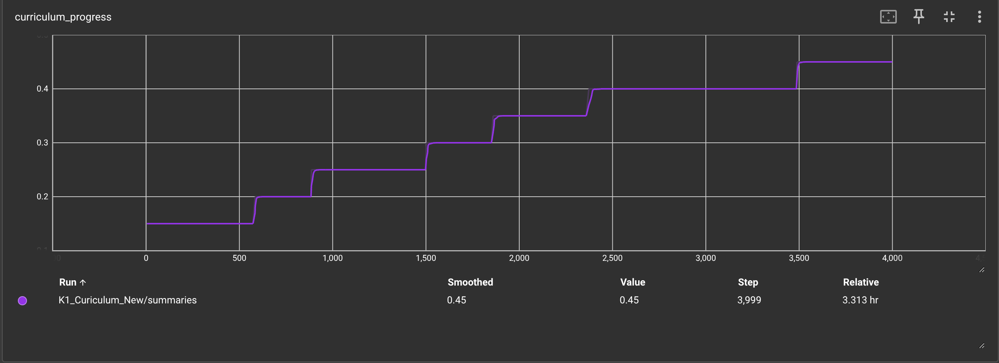

# Vision-Driven Reinforcement Learning for Humanoid Soccer Skills (Booster K1)

[](https://www.python.org/)
[](https://pytorch.org/)
[](https://github.com/mujocolab/mjlab)
[-orange.svg>)](#)

> **ICHIRO ITS Internship Final Project**  
> Adapting and extending [_"Learning Vision-Driven Reactive Soccer Skills for Humanoid Robots"_](https://humanoid-kick.github.io/) for the **Booster K1** humanoid robot using the **`mjlab` (MuJoCo-Warp)** GPU simulation backend and **Automated Curriculum Learning**.

---

## Demo & Visual Overview

<p align="center">
  
</p>

- **Full Demo Video (1--3 min):** [Link to Demo Video (YouTube / Google Drive)](https://drive.google.com/file/d/1caJ84jjlKKOmiQbSp5Fg7eDrrj7Mrrs1/view?usp=sharing)
- **Technical Report:** [Link to Technical Report PDF](docs/Technical_Report.pdf)

---

## 1. Overview

This repository implements an end-to-end **vision-driven reinforcement learning (RL)** framework that enables a **Booster K1** humanoid robot to perform reactive soccer skills—specifically **visual ball searching, approaching, aligning, and goal kicking**—relying solely on onboard proprioception and ego-centric camera perception.

While the reference implementation was designed for the 15-DOF Booster T1 robot on the deprecated NVIDIA Isaac Gym simulator, this project migrates the entire physics and training pipeline to **`mjlab` (`mujoco_warp`)** to support modern GPU architectures (such as NVIDIA Blackwell `sm_120`) and introduces algorithmic improvements in **curriculum learning**, **ego-centric visual memory**, and **directional kick alignment**.

### Key Contributions

1. **Physics Engine Migration (Isaac Gym $\rightarrow$ `mjlab` / MuJoCo-Warp):**
   - Replaced the deprecated PhysX/Isaac Gym backend with a zero-copy GPU parallel MuJoCo-Warp pipeline (`envs/base_task.py`) accelerated via CUDA Graph capture.
   - Built a pure PyTorch quaternion and coordinate transformation library (`utils/torch_math.py`) handling automatic conversion between MuJoCo (`wxyz`) and policy (`xyzw`) quaternion conventions.
2. **Morphological Adaptation to Booster K1 (14 DOF):**
   - Adapted the kinematic chain from Booster T1 (15 DOF with waist joint) to Booster K1 (14 DOF: 2 head joints + 12 leg joints, with arms locked as fixed bodies in `resources/K1.xml` and `resources/K1.urdf`).
   - Derived new state/action dimensions ($\mathcal{O} \in \mathbb{R}^{55}$, $\mathcal{O}_{\mathrm{critic}} \in \mathbb{R}^{67}$, $\mathcal{O}_{\mathrm{priv}} \in \mathbb{R}^{14}$, $\mathcal{O}_{\mathrm{AMP}} \in \mathbb{R}^{39}$, $\mathcal{A} \in \mathbb{R}^{14}$), morphological reflection matrices (`mirror_obs` and `mirror_act`) for symmetry loss, and static-equilibrium standing knee/ankle angles.
3. **Automated Curriculum Learning:**
   - Implemented an episodic success-rate-driven curriculum (`update_curriculum` in `envs/k1.py` and `utils/runner.py`) that progressively expands the ball and robot spawn distributions from near-goal zones ($p = 0.15$) to the full $14\text{ m} \times 9\text{ m}$ soccer pitch ($p = 1.0$) once the exponential moving average (EMA) episodic `success_rate` exceeds a target threshold.
4. **Active Vision Search, Out-of-FOV Ball Memory, & Kick Alignment:**
   - Decoupled neck joint scaling (`head_action_scale: 0.90` vs. leg `action_scale: 0.40`) and tuned active-gaze rewards (`face_ball_yaw`, `face_ball_pitch`) so the robot actively rotates its head to track balls located to its side.
   - Added a last-seen relative ball position memory mechanism in `ball_obs_buffer` when the ball exits the camera Field of View (`ball_in_view == 0`), preventing blind spinning when the ball stops near the feet.
   - Formulated an approach-behind-ball target and a cosine-similarity alignment reward (`_reward_align_ball_goal`) with goal-post collision avoidance.

---

## 2. Repository Structure

```text
final-project-ichiro/
├── data/                       # Reference motion capture CSV datasets for AMP
├── docs/                       # Figures, learning curves, and technical report (add images here)
├── envs/
│   ├── __init__.py             # Task registry (K1 and T1)
│   ├── base_task.py            # mjlab (MuJoCo-Warp) GPU parallel simulation backend
│   ├── k1.py                   # Booster K1 14-DOF soccer environment, curriculum & rewards
│   ├── K1.yaml                 # Hyperparameters, PD gains, and curriculum config for K1
│   ├── t1.py                   # Original Booster T1 environment
│   └── T1.yaml                 # Original Booster T1 configuration
├── logs/
│   └── K1_best.pth             # Pre-trained policy checkpoint for Booster K1
├── resources/
│   ├── meshes/                 # 3D STL meshes for Booster K1 & T1
│   ├── K1.urdf                 # Booster K1 14-DOF URDF for Pinocchio forward kinematics
│   ├── K1.xml                  # Booster K1 MJCF scene with ball, goal posts, and IMU/camera sensors
│   ├── K1_22dof.urdf           # Full 22-DOF Booster K1 URDF reference
│   └── K1_22dof.xml            # Full 22-DOF Booster K1 MJCF reference
├── utils/
│   ├── buffer.py               # Rollout experience buffer and AMP replay buffer
│   ├── model.py                # Actor-Critic, History Encoder, and AMP Discriminator networks
│   ├── motion.py               # Pinocchio-based AMP reference motion loader (14-DOF & 15-DOF)
│   ├── recorder.py             # TensorBoard & W&B episode statistics logger
│   ├── runner.py               # PPO + AMP + Symmetry Loss training loop & curriculum updater
│   ├── task_registry.py        # Environment task registration utility
│   ├── torch_math.py           # PyTorch quaternion & coordinate math utilities
│   ├── utils.py                # Domain randomization and GAE/PPO loss functions
│   └── wrapper.py              # Observation frame-stacking wrapper (num_stack = 50)
├── play.py                     # Evaluation & MP4 video recording script using mjlab backend
├── play_mujoco.py              # Interactive single-agent MuJoCo evaluation script
├── requirements.txt            # Python package dependencies
└── train.py                    # Main training entry point
```

---

## 3. Installation

This project is tested on **Ubuntu 24.04 LTS** with an **NVIDIA GeForce RTX 5050 Laptop GPU ($8\text{ GiB}$, Blackwell `sm_120`)** using **Python 3.11** and **CUDA 12.8+**.

### Step 1: Create a Conda Environment

```bash
conda create --name mjlab_env python=3.11 -y
conda activate mjlab_env
```

### Step 2: Install Pinocchio via Conda-Forge

Pinocchio is required by `utils/motion.py` to compute forward kinematics for Adversarial Motion Priors (AMP):

```bash
conda install -c conda-forge pinocchio libstdcxx-ng -y
```

### Step 3: Install PyTorch with CUDA 12.8 Support

```bash
pip install --upgrade pip
pip install torch torchvision --index-url https://download.pytorch.org/whl/cu128
```

### Step 4: Install `mjlab` and `mujoco-warp`

Clone and install `mjlab` alongside `mujoco-warp`:

```bash
git clone https://github.com/mujocolab/mjlab.git ~/mjlab
pip install -e ~/mjlab
pip install git+https://github.com/google-deepmind/mujoco_warp.git
```

### Step 5: Install Project Dependencies

```bash
cd /path/to/final-project-ichiro
pip install pyyaml tensorboard wandb imageio imageio-ffmpeg tqdm
```

Verify your GPU and `mjlab` installation:

```bash
python -c "import torch, mujoco, warp as wp, mjlab; wp.init(); print('GPU:', torch.cuda.get_device_name(0))"
```

---

## 4. Usage

### 4.1 Training a Policy

#### A. Train with Automated Curriculum Learning (Proposed Method)

Ensure `curriculum.enabled: true` is set in `envs/K1.yaml`, then run headless training across $2048$ parallel GPU environments:

```bash
python train.py --task=K1 --headless --num_envs=2048 --max_iterations=10000
```

#### B. Train Baseline without Curriculum (Ablation Study)

Set `curriculum.enabled: false` in `envs/K1.yaml` to spawn the robot and ball uniformly across the full pitch from iteration $0$:

```bash
python train.py --task=K1 --headless --num_envs=2048 --max_iterations=10000
```

#### C. Resume or Fine-Tune from a Checkpoint

To continue training or fine-tune from the latest saved model (`-1`) or a specific `.pth` file:

```bash
python train.py --task=K1 --headless --num_envs=2048 --checkpoint=logs/K1_best.pth --max_iterations=4000
```

#### Command-Line Arguments

- `--task`: Task name registered in `envs/__init__.py` (`K1`).
- `--headless`: Disable the interactive viewer window for faster GPU training.
- `--num_envs`: Number of parallel environments ($2048$ recommended for $8\text{ GiB}$ VRAM).
- `--checkpoint`: Path to a `.pth` checkpoint (set to `-1` to load the most recent checkpoint in `logs/`).
- `--max_iterations`: Total number of PPO training epochs.
- `--seed`: Random seed (default: `42`).

---

### 4.2 Monitoring Training Progress (TensorBoard)

All training metrics—including `reward`, `success_rate`, `fall_rate`, `ball_to_target_error`, `curriculum_progress`, and individual reward components (`episode/*`)—are logged automatically to `logs/<date-time>/`.

Launch TensorBoard with:

```bash
tensorboard --logdir logs
```

Then open `http://localhost:6006` in your browser.

---

### 4.3 Evaluation & Demo Simulation

#### Interactive MuJoCo Evaluation (`play_mujoco.py`)

To test the trained policy in an interactive real-time MuJoCo viewer window that tracks cumulative `Goal`, `Out`, and `Fall` counts:

```bash
# Load the pre-trained best checkpoint:
python play_mujoco.py --task=K1 --checkpoint=logs/K1_best.pth

# Or load the most recent checkpoint in logs/:
python play_mujoco.py --task=K1 --checkpoint=-1
```

#### Automated Video Recording (`play.py`)

To render simulation rollouts directly to an `.mp4` file in `videos/`:

1. Set `record_video: true` under the `viewer:` section in `envs/K1.yaml`.
2. Run:
   ```bash
   python play.py --task=K1 --checkpoint=logs/K1_best.pth --num_envs=1 --headless
   ```

---

## 5. Experimental Results

| Metric                         | Curriculum ON (Proposed) | Baseline (Curriculum OFF) |
| :----------------------------- | :----------------------: | :-----------------------: |
| **Peak Episodic Success Rate** |          `~41%`          |          `0.00%`          |
| **Final Fall Rate**            |          `~64%`          |         `~99.7%`          |
| **Mean Ball-to-Target Error**  |        `2.155 m`         |         `7.666 m`         |
| **Curriculum Level Reached**   |       $p = 0.20+$        |   N/A ($p = 1.0$ fixed)   |

### Learning Curves & Evaluation Plots

<p align="center">
  
  
</p>
<p align="center">
  
  
</p>

---

## 6. Acknowledgments & References

- **Reference Paper & Codebase:** [Learning Vision-Driven Reactive Soccer Skills for Humanoid Robots](https://humanoid-kick.github.io/)
- **Simulation Framework:** [mjlab](https://github.com/mujocolab/mjlab) & [MuJoCo-Warp](https://github.com/google-deepmind/mujoco_warp)
- **Foundational RL Frameworks:** [legged_gym](https://github.com/leggedrobotics/legged_gym) and [rsl_rl](https://github.com/leggedrobotics/rsl_rl)
- **Related Literature:**
  1. Haarnoja et al., _"Learning Agile Soccer Skills for a Bipedal Robot with Deep Reinforcement Learning"_, Science Robotics, 2024.
  2. Peng et al., _"AMP: Adversarial Motion Priors for Stylized Physics-Based Character Control"_, ACM Transactions on Graphics, 2021.
  3. Ji et al., _"DribbleBot: Dynamic Legged Manipulation in the Wild"_, IEEE ICRA, 2023.
